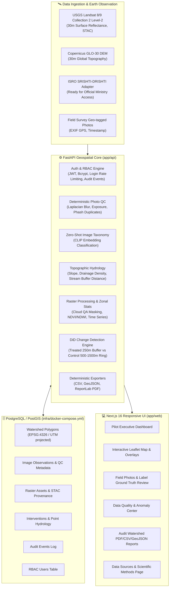

# VARUNI
### Integrated Geospatial Watershed Monitoring & Spatial Decision Support System

VARUNI is an evidence-first, open geospatial intelligence platform designed for national and state-level watershed development programs (e.g. WDC-PMKSY, MGNREGS, Jal Shakti Abhiyan). It bridges ground-level geo-coded field photography with 30 m multi-spectral satellite imagery and digital elevation models (DEM) to deliver deterministic hydrological analysis, seasonal vegetation monitoring, and Difference-in-Differences (DiD) change detection.

---

## 🏛️ System Architecture



---

## 🚀 Quickstart: 5-Command Setup

Get a complete local environment up and running in 5 commands:

```bash
# 1. Clone repository and navigate to workspace
git clone https://github.com/ammenish/Varuni.git && cd Varuni

# 2. Start PostgreSQL 16 with PostGIS 3.4
docker compose -f infra/docker-compose.yml up -d

# 3. Configure environment variables (seed admin credentials)
cp .env.example .env
# Edit .env to set your desired ADMIN_EMAIL, ADMIN_PASSWORD, and JWT_SECRET_KEY

# 4. Run automated pilot demonstration setup (starts in ~30s)
make demo

# 5. Start the frontend web portal
make dev-web
```

Open your browser at **[http://localhost:3033](http://localhost:3033)** and log in with your configured admin credentials.

---

## 📋 Demonstration Script Order

To evaluate the platform end-to-end, follow this operational walkthrough:

1. **Authentication & Role-Based Access Control**:
   - Access [http://localhost:3033/login](http://localhost:3033/login).
   - Sign in using your seeded admin account.
   - Verify unauthenticated requests to protected endpoints return `401 Unauthorized` and role violations return `403 Forbidden`.
2. **Pilot Catchment & Topography**:
   - Navigate to **Map View** to inspect the Sukhi Nadi Pilot Watershed polygon (`162.24 sq km`).
   - Toggle the DEM elevation layer, slope contours, and drainage stream network.
3. **Multi-Spectral Time-Series & Overlay**:
   - In the Map View, switch raster overlays between **NDVI** (Vegetation) and **NDWI** (Water index).
   - Inspect the historical monthly time series chart reflecting cloud-filtered Landsat 8/9 scenes.
4. **Field Photo Quality Control & Zero-Shot Classification**:
   - Navigate to **Photos & Field Data** to inspect uploaded ground photos.
   - Observe the non-ML deterministic QC panel (blur score, clipped-pixel exposure, SHA-256 / perceptual hash duplication checks, and GPS bounding box sanity).
   - Review the Zero-Shot CLIP taxonomy label (`check_dam`, `farm_pond`, `plantation_vegetation`, etc.) and submit reviewer ground-truth confirmation.
5. **Difference-in-Differences (DiD) Observed Change**:
   - Select an intervention (e.g. Masonry Check Dam).
   - Execute the DiD engine comparing treated buffer (`250 m`) against control ring (`500–1500 m`) across baseline and comparison years in the same seasonal window ($\pm 20$ days).
   - Results are scientifically presented with non-causal disclaimer wording (**"observed change"**).
6. **Deterministic Reports & Exports**:
   - Open **Reports & Downloads**.
   - Generate and download the comprehensive watershed **PDF Report**, **GeoJSON Spatial Data**, and **CSV Observation Log**.

---

## 📡 Data Sources & Provenance Standards

| Dataset | Provider / Source | Resolution | Usage in VARUNI |
| :--- | :--- | :--- | :--- |
| **Surface Reflectance (B2–B7)** | USGS / NASA Landsat 8 & 9 Collection 2 Level-2 | 30 m | NDVI ($\frac{\text{NIR}-\text{Red}}{\text{NIR}+\text{Red}}$), NDWI ($\frac{\text{Green}-\text{NIR}}{\text{Green}+\text{NIR}}$), QA Cloud Masking |
| **Digital Elevation Model (DEM)** | Copernicus Global DEM (GLO-30) | 30 m | Elevation profiles, slope degrees (Zevenbergen-Thorne), stream network extraction |
| **Watershed Boundaries** | Survey of India / India-WRIS / State GIS Portals | Vector (EPSG:4326) | Catchment area, perimeter calculation (projected UTM), spatial joins |
| **Field Photography** | Ground Surveyors / Mobile App | Native Exif | GPS spatial join, Laplacian blur QC, exposure metrics, zero-shot taxonomy |

---

## 🇮🇳 Plugging in ISRO / SRISHTI-DRISHTI

VARUNI is architected with a modular, provider-agnostic Earth Observation interface designed specifically for seamless onboarding of indigenous ISRO data:

- **Provider Interface**: Located at `app/api/satellite/providers/srishti_drishti.py`.
- **Implementation Steps**:
  1. Obtain official ministry/NRSC API endpoint and OAuth credentials.
  2. Implement `search_scenes(bbox, start_date, end_date, max_cloud)` to query the official ISRO catalog.
  3. Implement `get_band_raster_url(scene_id, band_name)` returning secure signed URLs for Green, Red, NIR, SWIR1, and QA bands.
  4. In `app/api/satellite/ingest.py`, set the active provider to `SrishtiDrishtiProvider()`. All downstream index processing, cloud QA masking, and PostGIS ingestion execute automatically without requiring changes to downstream analytical models or the UI.

---

## ⚠️ Known Limitations & Methodological Constraints

For a detailed breakdown of scientific assumptions, cloud contamination thresholds, slope algorithms, and non-causal attribution boundaries, please consult **[docs/KNOWN_LIMITATIONS.md](file:///Users/zaidfaridi/Downloads/PROJECTS%20/VARUNI%20/Varuni/docs/KNOWN_LIMITATIONS.md)**.

---

## 🧪 Testing & CI

Execute the test suites locally:

```bash
# Run backend pytest (37 test cases) and frontend tests
make test

# Run code linters
make lint
```

Continuous integration is automated via GitHub Actions (`.github/workflows/ci.yml`) on all branches and pull requests.
